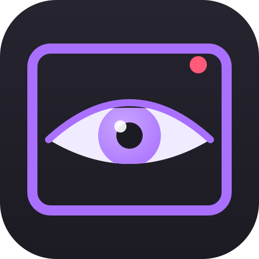

<div align="center">



# Lurkly

**A tab for every channel you follow that is live.**
A minimal Twitch viewer for Linux.

[](https://github.com/shatteredeagle/lurkly/actions/workflows/ci.yml)
[](LICENSE)

<!-- TODO: replace with a real screenshot (docs/screenshot.png) before publishing. -->


</div>

## Overview

The Twitch website is built for browsing. Lurkly is built for watching the people you already follow. Sign in once and it opens one small window with **a tab for every followed channel that is live right now**. Tabs appear and disappear as streams start and end. There are no recommendations, no front page and no sidebar, just the stream, and chat if you want it.

Playback and chat are Twitch's own official embeds, so the video is the real player and chat is the real chat.

## Features

- **Device-code sign-in.** No passwords or tokens to paste. Lurkly only asks for `user:read:follows`.
- **One tab per live followed channel,** busiest first, refreshed every 60 seconds. New streams get a tab, and channels that go offline fade out and close themselves.
- **Official Twitch embed player** with its own controls hidden. Click to pause, double-click for fullscreen, mouse wheel for volume, plus keyboard shortcuts.
- **Optional chat,** docked on the right and resizable by dragging its edge.
- **Grid mode:** 1x1, 2x1, 1x2, 2x2, 3x2 or 3x3.
  - Drag a tab onto a cell to play it there, or use the per-cell picker.
  - Audio follows the focused cell; the rest stay muted.
- **Fullscreen** with a translucent tab bar that hides itself when you are not using it.
- **Tab overflow:** when tabs run out of room, a `+N` button opens a list of every live channel.
- **Themes:** Auto (follows your system), Light or Dark.
- **Always on top** and a **mini mode** that collapses the window to just the video.
- **Update notice:** checks GitHub releases once a day (switch it off in Settings) and tells you when a newer version is out. Settings has a **Check for updates** button that opens the release page. It never replaces itself, so `.deb`, `.rpm` and Arch installs stay under your package manager's control.
- Frameless window with its own title bar. One instance at a time.

## Keyboard shortcuts

| Key | Action |
|---|---|
| `C` | Toggle chat |
| `F` | Toggle fullscreen |
| `M` | Mute / unmute |
| `Up` / `Down` | Volume +5% / -5% |
| `G` | Cycle grid layouts |
| `Ctrl+1` ... `Ctrl+9` | Jump to tab 1 to 9 |
| `Ctrl+Tab` / `Ctrl+Shift+Tab` | Next / previous tab |
| `Ctrl+K` | Open the list of all live channels |
| `Ctrl+W` | Close the current tab (middle-click a tab does the same) |
| `Ctrl+M` | Toggle mini mode |
| `Esc` | Close a popup, or leave fullscreen |

On the video: click pauses or plays (the first click on an unfocused grid cell just focuses it), double-click toggles fullscreen, and the wheel changes volume.

## Install

Download a package from the [latest release](../../releases/latest):

| Distro | Package |
|---|---|
| Debian, Ubuntu | `.deb` |
| Fedora, openSUSE | `.rpm` |
| Arch | `.pkg.tar.zst`, or `makepkg -si` from a clone |
| Anything else | `.AppImage` |

Runtime needs `webkit2gtk-4.1` and `gtk3`. Only Linux is built and tested.

## First run

1. Launch **Lurkly** and click **Sign in**.
2. A Twitch window opens with a code already issued. Log in if asked and click **Authorize**.
3. The window closes and your live channels appear as tabs.

The token is stored in `auth.json` in the app's config directory (`~/.config/dev.lurkly.app/` on most systems), readable only by you (`0600`). Lurkly only requests the `user:read:follows` scope, which lets it see who you follow and who is live. It cannot post, chat or change anything on your account.

## How it works and privacy

```
Twitch API (Helix) ◀── Rust backend, every 60 s ──▶ tabs
Twitch embed player + chat ──▶ webview, served from localhost
```

- Lurkly talks only to Twitch: the sign-in endpoints, the Helix API (followed streams, avatars) and the official player and chat embeds. There are no other servers, no analytics and no telemetry.
- The backend does the sign-in, token refresh and follow list. The interface is a local page the app serves to itself on `localhost`, which is what lets Twitch's embed accept it as a parent.
- The Twitch login window and the players live in the same webview session. A signed-in viewer is therefore treated by the embeds as a normal signed-in viewer on twitch.tv, so your own account's behaviour applies (for example, subscriber perks). Whether that includes fewer or no ads is decided by Twitch and can change, so Lurkly makes no promise about it.

## FAQ

**Why only Linux?** Lurkly is built with Tauri 2, which also targets Windows and macOS, but the embed and login behaviour has only been tried on WebKitGTK. Other platforms may come later.

**Why is chat the official embed and not a custom one?** It is the real chat, so you can type, and your badges and subscriber emotes work with no maintenance. The trade-off is that it looks like stock Twitch chat and can only be themed light or dark.

**Why does it use the follow list and not my subscriptions?** The follow list is what Twitch's `user:read:follows` scope exposes, and it is the smallest permission that does the job. Subscribing to a channel normally follows it too, so those channels show up.

**How do I sign out?** Settings (gear icon), then **Sign out**. This deletes `auth.json`. You can also revoke Lurkly under Connections in your Twitch account settings.

**Will I see ads, and do my sub perks apply?** Lurkly shows Twitch's own player in a session you sign in to, so it behaves like Twitch in a browser for your account. Ad and subscriber behaviour is controlled entirely by Twitch and may differ from the website or change over time. Lurkly does not block, skip or hide ads.

**The tab list has a `+N` button.** That is the overflow list. It shows every live channel, and picking one opens or switches to its tab. `Ctrl+K` opens it too.

## Build from source

Needs Rust, `webkit2gtk-4.1` and `gtk3` (plus their `-dev` packages on Debian-based systems) and the Tauri CLI.

```sh
cargo install tauri-cli --locked
cargo tauri build              # .deb / .rpm / AppImage in src-tauri/target/release/bundle/
```

For a quick run, `cargo tauri dev` from the repo root. Pushing a `vX.Y.Z` tag builds and publishes a release (see `.github/workflows/release.yml`); the tag must match the version in `Cargo.toml` and `tauri.conf.json`. Changes are listed in [CHANGELOG.md](CHANGELOG.md).

## Not affiliated

Lurkly is an unofficial fan project. It is not affiliated with, endorsed by or sponsored by Twitch. Twitch is a trademark of Twitch Interactive, Inc.

## Licence

[AGPL-3.0-or-later](LICENSE)
